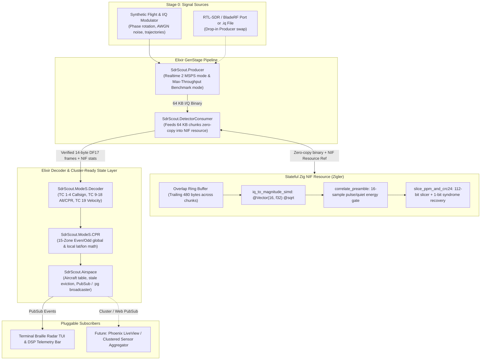

# SDR Receiver in Elixir + Zig: Implementation Plan

This plan establishes a software-defined radio (SDR) Mode-S / ADS-B (1090 MHz) receiver built with **Zig** (stateful NIF resource, SIMD-accelerated I/Q magnitude, sliding-window preamble correlation, PPM bit slicing, CRC-24 verification, and 1-bit syndrome error correction) and **Elixir** (complex baseband synthetic RF generator, `GenStage` demand-driven streaming pipeline, bitstring frame dissection, CPR spatial decoding, and a PubSub-decoupled `Airspace` state tracker).

Because hardware is separate from initial development, we develop against a **synthetic complex baseband I/Q flight simulator** (supporting phase rotation, AWGN noise, and bit errors) plus **standard Mode-S/ADS-B test vectors**. Switching to a live RTL-SDR or BladeRF requires only swapping the `GenStage` producer. Furthermore, all decoded telemetry and airspace updates are broadcast over pub/sub so the presentation layer (Terminal TUI radar today, clustered Phoenix LiveView nodes tomorrow) is completely decoupled.

---

## 1. Architectural Decisions & Why ADS-B (1090 MHz) Fits

| Layer / Component | Design Choice & Rationale |
| :--- | :--- |
| **Input Format** | 2.0 MSPS (Mega-samples/sec), unsigned 8-bit I/Q pairs (`u8` pairs centered at `127.5`, 4 MB/sec raw stream). |
| **Stateful Zig NIF Resource (`Zigler`)** | Holds a persistent 240-sample (480-byte) chunk-overlap tail buffer and live DSP telemetry counters (`samples_processed`, `preambles_found`, `crc_valid`, `single_bit_fixes`) inside Zig so Elixir passes 64 KB chunks with zero binary concatenation/copying. |
| **SIMD Magnitude (`@Vector(16, f32)`)** | Converts raw `u8` $I/Q \to \sqrt{(I-127.5)^2 + (Q-127.5)^2}$ using 16-lane vector casts and `@sqrt`. True linear amplitude prevents isolated noise spikes from skewing preamble energy sums. |
| **Preamble & PPM Slicer (Zig)** | 8 µs (16-sample) pulse/quiet ratio matched filter + 112-bit (224-sample) Pulse Position Modulation (PPM) bit slicer that records per-bit confidence deltas ($|A - B|$). |
| **CRC-24 & 1-Bit Error Correction (Zig)** | Hardware-rate CRC-24 (`0xFFF409` / `0xFFFA0480`) lookup + syndrome table in Zig. When a candidate frame fails CRC by a single bit error, Zig flips the syndrome-identified bit before emitting the 14-byte frame to Elixir. |
| **Elixir Protocol & CPR Math** | Idiomatic Elixir bitstring pattern matching for `DF17`/`DF18` Extended Squitter: Aircraft Identification (TC 1–4), Barometric Altitude + Global/Local Compact Position Reporting (CPR, TC 9–18), and Airborne Velocity/Heading (TC 19). |
| **Cluster-Ready PubSub Decoupling** | `SdrScout.Airspace` tracks live aircraft state and broadcasts updates via `Registry` / `:pg` (or `Phoenix.PubSub` ready), keeping the door open for multi-node SDR sensor clustering and a Phoenix LiveView web frontend. |

---

## 2. Architecture: Micro (Zig NIF) vs. Macro (Elixir OTP)

---

## 3. Milestones & Task Breakdown

### Phase 1: Mode-S / ADS-B Protocol Core & Decoders (Elixir)
*Objective: Establish reference CRC-24, frame encoders/decoders, and CPR math first so we can both decode real packets and synthesize realistic multi-aircraft flight trajectories.*
- [ ] **Task 1.1: Reference Test Vectors & CRC-24 (`SdrScout.ModeS.CRC`)**
  - Implement reference Mode-S CRC-24 generator polynomial (`0xFFF409` / `0xFFFA0480`) for verifying and stamping 112-bit frames.
  - Create `SdrScout.TestVectors` with real captured `DF17` hex frames (callsign, airborne position even/odd pairs, velocity).
- [ ] **Task 1.2: Bitstring Dissector (`SdrScout.ModeS.Decoder`)**
  - Pattern match `DF17` / `DF18` 14-byte frames (`<<df::5, ca::3, icao::24, me::binary-size(7), pi::24>>`).
  - Decode **TC 1–4** (Aircraft Identification / 6-bit AIS callsign character table).
  - Decode **TC 9–18** (Airborne Position: 12-bit Gillham/Q-bit barometric altitude, CPR odd/even flag, 17-bit encoded lat/lon).
  - Decode **TC 19** (Airborne Velocity: Subtype 1/2 ground speed $v_{EW}, v_{NS} \to$ knots & heading in degrees, plus vertical rate in ft/min).
- [ ] **Task 1.3: Compact Position Reporting (`SdrScout.ModeS.CPR`)**
  - Implement exact 15-zone ($NZ = 15$) latitude index $j$, $\text{NL}(\text{lat})$ longitude zone count lookup/trig formula, and globally unambiguous Even/Odd frame pairing.
  - Implement inverse CPR encoding helper for the synthetic flight simulator.

---

### Phase 2: Synthetic Complex Baseband RF Generator (Elixir)
*Objective: Simulate realistic multi-aircraft RF streams with phase rotation, noise, and chunk-straddling frames to stress-test the Zig DSP kernel.*
- [ ] **Task 2.1: Baseband I/Q Modulator (`SdrScout.Synth.Modulator`)**
  - Take 14-byte (112-bit) Mode-S frames, prepend the 16-sample preamble (`[1, 0, 1, 0, 0, 0, 0, 1, 0, 1, 0, 0, 0, 0, 0, 0]`), and PPM-encode the 112 bits into 224 samples (`1 -> [1, 0]`, `0 -> [0, 1]`).
  - Apply random carrier phase rotation $\theta \in [0, 2\pi)$ so signal amplitude splits across $I = 127.5 + A\cos(\theta)$ and $Q = 127.5 + A\sin(\theta)$.
  - Inject configurable AWGN (Gaussian/uniform white noise) and optional synthetic single-bit flips to test Zig's syndrome error recovery.
- [ ] **Task 2.2: Multi-Aircraft Trajectory Simulator (`SdrScout.Synth.Scenario`)**
  - Generate continuous streams of 64 KB chunks containing simulated aircraft flying realistic headings/altitudes/speeds, deliberately placing frames across 64 KB chunk boundaries.

---

### Phase 3: Stateful High-Throughput DSP Kernel in Zig (`Zigler`)
*Objective: Process 2.0+ MSPS in a stateful Zig NIF resource with SIMD magnitude, preamble detection, PPM slicing, and 1-bit CRC-24 error correction.*
- [ ] **Task 3.1: `Zigler` Setup & Stateful NIF Resource (`SdrScout.Native.Dsp`)**
  - Configure `zigler` in `mix.exs`.
  - Define a Zig resource struct holding the 480-byte overlap tail buffer (240 samples) and cumulative telemetry counters (`samples_processed`, `preambles_detected`, `crc_passed`, `single_bit_corrected`).
- [ ] **Task 3.2: SIMD Linear Magnitude (`@Vector(16, f32)`)**
  - Process incoming `u8` I/Q pairs in 16-sample SIMD lanes: center at `127.5`, compute $\sqrt{\Delta I^2 + \Delta Q^2}$ using `@sqrt`, and populate the magnitude working buffer.
- [ ] **Task 3.3: Preamble Correlator & PPM Bit Slicer**
  - Slide the 16-sample Mode-S preamble window over the magnitude buffer, checking pulse positions (`0, 2, 7, 9`) against quiet positions (`1, 3, 4, 5, 6, 8, 10..15`) and SNR threshold.
  - Slice the following 224 samples into 112 bits (14 bytes).
- [ ] **Task 3.4: In-Zig CRC-24 & 1-Bit Syndrome Error Recovery**
  - Compute the 24-bit Mode-S CRC remainder in Zig.
  - If remainder is `0`, emit the frame immediately.
  - If remainder is non-zero, match the 24-bit syndrome against the 112 single-bit error syndromes; if matched, flip the corrupted bit, increment `single_bit_corrected`, and emit the rescued frame.
- [ ] **Task 3.5: NIF Unit & Property Verification**
  - Test clean synthetic frames, phase-rotated noisy frames, single-bit corrupted frames, and frames split across two consecutive 64 KB chunks.

---

### Phase 4: `GenStage` Pipeline, Cluster-Ready `Airspace`, & Terminal Radar
*Objective: Demand-driven streaming with backpressure, decoupled PubSub state, and a live terminal radar + benchmark runner.*
- [ ] **Task 4.1: `GenStage` Pipeline (`SdrScout.Pipeline.Producer` & `DetectorConsumer`)**
  - Support **Realtime Mode** (2.0 MSPS paced emission) and **Benchmark Mode** (unthrottled `GenStage` demand to measure peak MSPS throughput of the Zig NIF).
- [ ] **Task 4.2: Cluster-Ready Airspace Tracker (`SdrScout.Airspace`)**
  - Maintain aircraft state by 24-bit ICAO address (callsign, altitude, CPR even/odd cache, decoded lat/lon, ground speed, heading, vertical rate, message count, last seen timestamp).
  - Broadcast state diffs via `:pg` / `Registry` pub/sub so any local or remote subscriber (TUI, Phoenix LiveView, logger) can attach cleanly.
- [ ] **Task 4.3: Terminal Braille Radar TUI (`SdrScout.TUI`) & CLI Runner**
  - Subscribe to `SdrScout.Airspace` and render a live terminal dashboard: Unicode Braille ($2 \times 4$ sub-cell resolution) polar radar scope, tracked aircraft table, and Zig NIF throughput/CRC recovery metrics.

---

### Phase 5: Hardware Plug-in
- [ ] Add `SdrScout.Pipeline.RtlSdrProducer` wrapping an Erlang Port (`rtl_sdr -f 1090000000 -s 2000000 -`) or raw `.iq` capture file reader.
